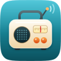
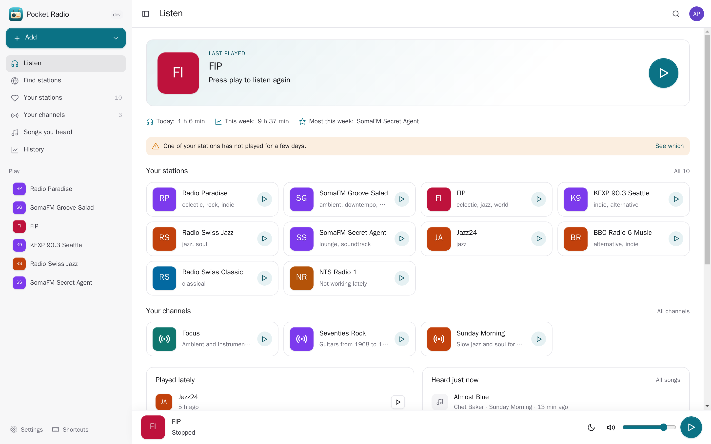
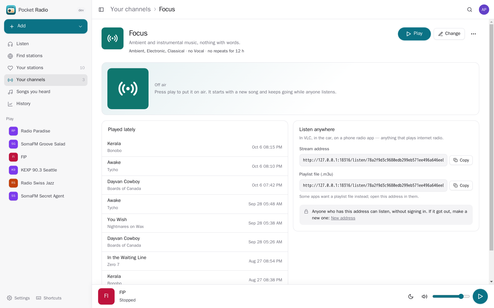
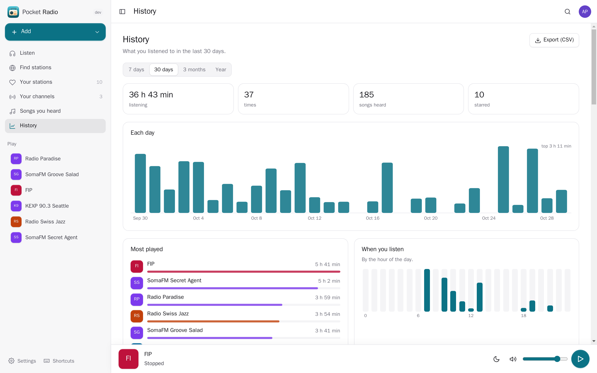
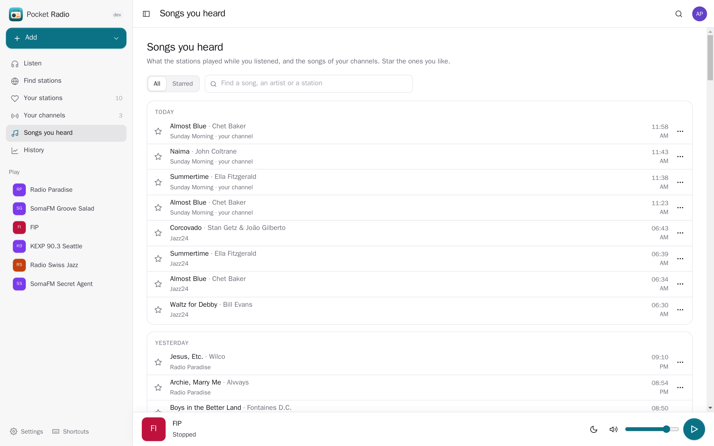
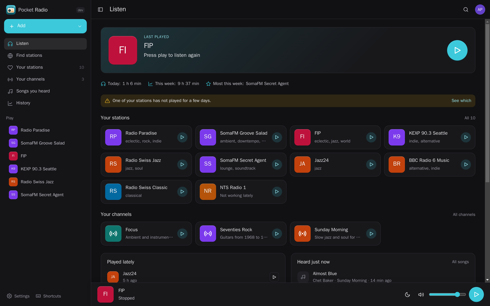
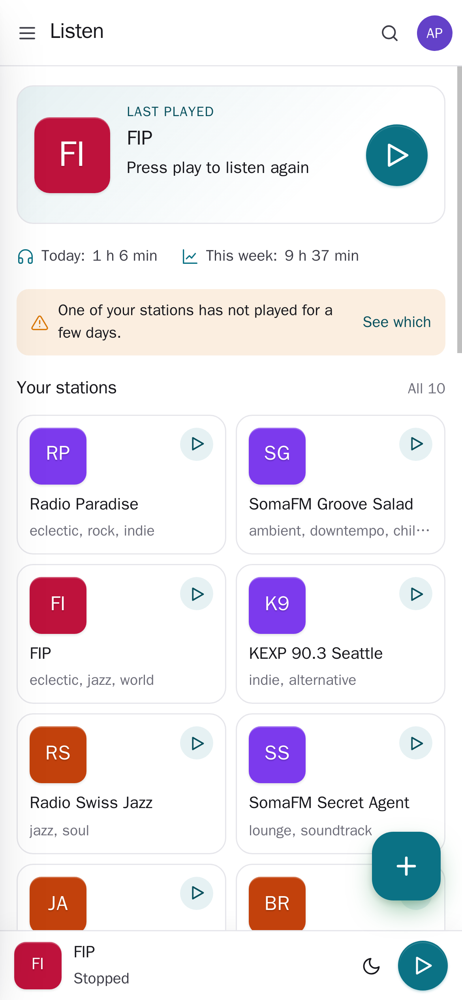
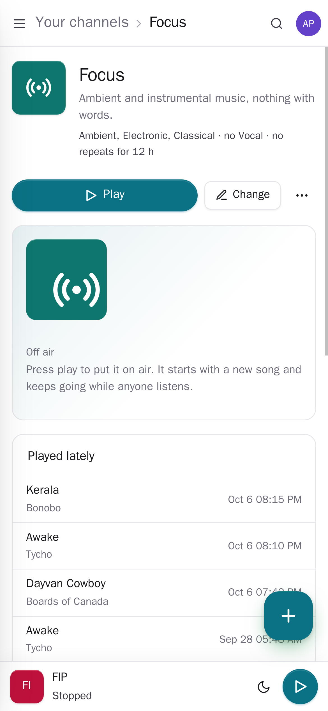

<p align="center"></p>
<h1 align="center">Pocket Radio</h1>
<p align="center">Internet radio on your own server, and stations of your own. Find stations from all over the world, keep your favourites, see the song that is playing and keep the ones you like; and make channels from your own music library that play like real radio — the same song on the phone, in the car and in any radio app.<br>One Go binary, one SQLite file, one volume. Part of the Pocket apps; works on its own too.</p>
<p align="center">
  <a href="https://github.com/abjelosevic88/pocket-homelab-radio/actions"></a>
  <a href="https://github.com/abjelosevic88/pocket-homelab-radio/pkgs/container/pocket-homelab-radio"></a>
  <a href="LICENSE"></a>
</p>

---

<p align="center"></p>

<table>
  <tr>
    <td width="50%"></td>
    <td width="50%"></td>
  </tr>
  <tr>
    <td align="center"><sub>A channel from your own music: the rules, what it played, and one address for VLC, the car or a radio app.</sub></td>
    <td align="center"><sub>History: how much you listen, when, and to what.</sub></td>
  </tr>
  <tr>
    <td width="50%"></td>
    <td width="50%"></td>
  </tr>
  <tr>
    <td align="center"><sub>Songs you heard: every title the stations sent; star the ones you want to find again.</sub></td>
    <td align="center"><sub>Dark mode follows your system.</sub></td>
  </tr>
  <tr>
    <td width="50%"></td>
    <td width="50%"></td>
  </tr>
  <tr>
    <td align="center"><sub>On the phone: the player stays at the bottom, the lock screen shows the song.</sub></td>
    <td align="center"><sub>Your channels go with you.</sub></td>
  </tr>
</table>

- **Find stations**: search the open [radio-browser.info](https://www.radio-browser.info) list (about 50,000 stations) by name, genre and country, or what is popular where you live; play one without keeping it; or add any station by its address (`.pls` and `.m3u` files are unwrapped for you).
- **Played through the server**: plain-http stations play on an https page, and the song titles a station puts inside its stream are read out — you see what is on, and every song lands in "Songs you heard". HLS stations play straight in the browser.
- **Your stations**: favourites in your order, recently played, a daily check that each still plays (a message when one stops for three days), import and export as M3U for other radio apps, and the stations kept in Navidrome.
- **Channels of your own**: pick genres, artists, playlists, years or only your starred songs — or describe it in your own words and let AI pick the genres your library has. A preview shows about how many songs fit. No song again within hours you choose, a gap before the same artist comes back.
- **Real radio, not a playlist**: while anyone listens, one broadcast plays for all of them, at the bitrate you set. `/listen/<secret>.mp3` works in VLC, the car, a smart speaker or any phone radio app, with song titles; `.m3u` and `.pls` files point at it.
- **Songs you heard**: star a song, ask whether it is already in your music library and keep it in a Pocket Music playlist.
- **History**: minutes per day and week, the hours you listen, top stations and channels, export as CSV.
- **Sleep timer**, lock-screen and headphone controls, keyboard shortcuts (space plays and stops), light and dark.
- **Everyone their own**: each person has their own stations, channels, history, music library and settings; admins see no one else's.

## Run it

```sh
docker run -d --name pocket-radio -p 8080:8080 -v ./data:/data \
  -e BASE_URL=https://radio.example.com -e SECURE_COOKIES=true \
  ghcr.io/abjelosevic88/pocket-homelab-radio:latest
```

or `docker compose up -d` with [docker-compose.yml](docker-compose.yml). Open it, create the first account and find a station. For channels, connect your Navidrome under Settings → Connected apps (Navidrome's MP3 transcoding must be on — it is by default). The server refuses to fetch stations on private addresses unless `ALLOW_LOCAL_STREAMS=true`; `RADIO_DIRECTORY_URL=off` turns the directory off. All options: [docs/configuration.md](docs/configuration.md). API: [docs/api.md](docs/api.md). Backups: [docs/backup.md](docs/backup.md).

## With Pocket Core

Set `CORE_URL` and `CORE_REGISTRATION_KEY` and Radio joins the box: people sign in with Pocket Core, each person's own Navidrome login comes from Core (service `navidrome`), and heard songs are matched in Pocket Music and kept in a playlist there (`playlists:write`) — nothing to paste. "Describe a channel" uses Pocket AI. Other Pocket apps can read your stations, channels, what plays now, your history and the songs you heard (`radio:read`, e.g. Pocket Day's journal) or add a station to your favourites (`radio:write`). Events on the bus: `radio.listened`, `radio.song_saved`, `radio.station_added`. Without Core every connection can be made directly; the Core-only choices stay visible, greyed out.

## Develop

```sh
make dev     # API on :8080 with demo data + Vite on :5173
make test    # go vet, go test, tsc
make         # web + binary
```

`internal/server/relay.go` is the station relay (ICY titles out of the stream), `broadcast.go` + `mp3.go` the channel broadcaster (MP3 frames sent in real time to every listener), `pick.go` how a channel chooses songs, `netguard.go` the guard on everything the server fetches for people. The demo stations are real public stations; the demo listening is made up. Station data from radio-browser.info (public domain). MIT licensed.
